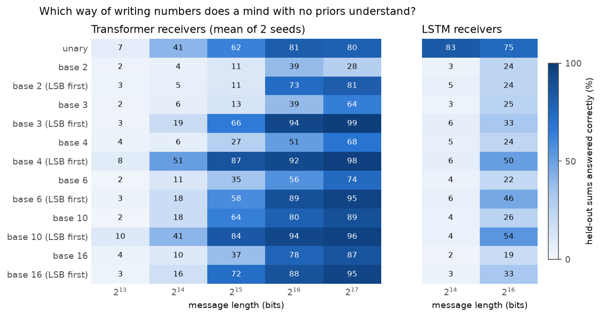

# Arecibo Zero

[](https://github.com/PS12007/arecibo-zero/actions/workflows/tests.yml)

**How should we write to a mind that knows nothing? Test interstellar message designs on neural networks that start from zero, then read the message back out of their heads.**

Every first-contact message (Arecibo 1974, Lincos, Cosmic Call) starts by teaching numbers, and every one rests on untested guesses about what a receiver will find obvious. This project tests those guesses. A *sender* writes a message under a fixed bit budget, choosing the number system, digit order and content. A *receiver*, a randomly initialised transformer or LSTM, is trained on that one message and nothing else, purely to predict the next symbol. It is never told what any symbol means. It is then examined on **sums the message never contained**: a quarter of all operand pairs below 64 are withheld in both orders, so the only way to answer is to have extracted the rule of addition.

- 📄 **Technical report:** [docs/arecibo-zero.pdf](docs/arecibo-zero.pdf) ([HTML](https://ps12007.github.io/arecibo-zero/paper.html))
- 👽 **Interactive demo:** [ps12007.github.io/arecibo-zero](https://ps12007.github.io/arecibo-zero/). Listen to a transmission in alien glyphs, then **ask a trained receiver sums it has never heard**: a 418k-parameter transformer running in your browser, in plain JavaScript.



## Key results

434 receivers, all trained from scratch on one laptop GPU.

| Finding | Number |
|---|---|
| Least-significant digit first beats most-significant first in **every** base. Held-out sums at 2<sup>15</sup> bits, base 4 | **87% vs 27%** |
| LSB first ahead in matched (base, length, seed) cells, excluding ties at the floor (sign test *p* = 4×10<sup>−12</sup>; mean gain 21 pts, 95% CI 16–27) | **47 of 49** |
| Bits needed to reach 50% held-out accuracy: base 4 LSB-first (best) / base 10 LSB-first / base 10 as humans write it | **16k** / 19k / 27k |
| Binary written MSB-first (the Arecibo choice): held-out accuracy at 2<sup>17</sup> bits | 28%, never reaches 50% |
| LSTMs, unary tally marks, 2<sup>14</sup> bits (just **41 example sums**; three seeds) vs every positional system | **51–83%** vs ≤ 7% |
| Content: accuracy predicted from the number of sums alone; extra counting / products change it by | ≈ 0 / −8 to −11 pts |
| Raw-bit channel: same 2<sup>16</sup> bits as 5-bit codewords with no symbol boundaries vs as symbols | **≈1%** vs 91% |
| Blind decipherment of shuffled messages from the receiver alone (base, digit values, order, +, ×, < = >) | **5 of 12** complete |
| Bare question vs the same question after a single end-of-statement symbol (12 receivers): the context is framing, not examples | 48% vs **71%** |
| Genetic design search on transformers: champion vs human decimal vs Arecibo-style binary (2<sup>14</sup> bits) | **44%** (base 4, LSB-first) vs 18% vs 5% |
| Sent to fresh receivers of 5 kinds, mean held-out accuracy: plain unary sums vs transformer champion vs decimal vs Arecibo-style binary | **43%** vs 16% vs 10% vs 3% |

## Results to read carefully

- **The best design depends on the mind.** Transformers do best with base 4 (or 10) written LSB-first; LSTMs do best with tally marks, which leave transformers on a plateau near 80%. No single design is best for both. A genetic search on transformers rediscovered base 4 LSB-first on its own; an LSTM search allowed to use tally marks switched to them within two generations. Sent to fresh receivers, each champion did well only on the kind of mind it was tuned for. Plain unary sums, which no search proposed, were the only design every kind of receiver understood (28–56%). Tuning a message to one mind over-fits it.
- **Counting first teaches nothing about addition.** The traditional opening of interstellar messages costs about half the budget when it is 30% of statements and gives no head start. Bits spent on a concept teach that concept, not its neighbours.
- **Framing is the hardest part.** Receivers that learn arithmetic from 2<sup>14</sup> symbol-level bits learn nothing from 2<sup>16</sup> raw bits. So noise and repetition coding could not be compared: everything was at the floor. With 4× the training the receivers nearly memorise the bit stream (loss down tenfold) yet answer only 4–5% of held-out sums.
- **Decipherment fails in two ways.** Receivers that understood poorly (base 3 MSB-first, 27–30%) cannot be read. Base-16 receivers understood well (81%), but the probe found only the 7 digits that ever lead a numeral.
- **Receivers memorise their message and still generalise.** With 8 symbols of context a base-10 receiver predicts the next symbol with median probability 0.99, enough to locate itself in a 28k-symbol message. Its hidden state's main axis marks whether a numeral is an operand or an answer, not its size (report Fig. 5).
- **Seeds matter near the threshold.** Delayed, grokking-like generalisation makes two seeds of the same design differ by up to 40 points (binary LSB-first at 2<sup>16</sup>: 53% and 94%).
- **The 1,679-bit Arecibo message is far too short for these receivers.** Nothing learned anything at 8,192 bits.

## How it works

| Piece | File |
|---|---|
| Message designs: radix 1–16, digit order, sums / products / comparisons / counting, bit budget, held-out exam pairs | [`arecibo/message.py`](arecibo/message.py) |
| Receivers (transformers, LSTMs), training, and the exam (greedy answers after a real stretch of message) | [`arecibo/receivers.py`](arecibo/receivers.py) |
| Batched trainer: up to 10 transformers with stacked weights in one model | [`arecibo/ensemble.py`](arecibo/ensemble.py) |
| Raw-bit channel: random codewords, repetition coding, bit flips | [`arecibo/channel.py`](arecibo/channel.py) |
| Blind decipherment: roles from the receiver's expectations, a counting probe, operator matching | [`arecibo/decipher.py`](arecibo/decipher.py) |
| Experiments: radix, content, channel, decipher, evolve (+ transfer), cold exam, paired stats, figures, demo export | [`experiments/`](experiments) |
| In-browser receiver (checked against PyTorch to 1.5e-5) | [`docs/receiver.js`](docs/receiver.js) |

## Run it

```bash
pip install -r requirements.txt     # plus a CUDA build of PyTorch for speed
sh run_all.sh                       # every experiment, then figures; resumable
python -m pytest tests -q           # fast CPU checks (exam pairs never transmitted, codecs, channel)
```

Nothing is downloaded: every message is generated. On a laptop RTX 5060 the whole pipeline takes about 10 hours, most of it the radix sweep.

## Repository layout

```
arecibo/        messages, receivers, batched trainer, channel, decipherment
experiments/    radix, content, channel, decipher, decipher_exam, cold_exam, evolve, stats, figures, export, export_model
results/        per-receiver JSON results (small, committed)
docs/           demo page, in-browser receiver, report (HTML + PDF), figures, demo data
tests/          CPU unit tests
```

*Built autonomously by Claude Code as a research exercise; every number in the report is produced by the code in this repository.*
